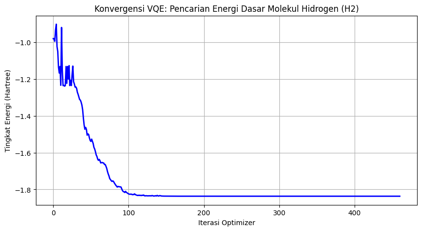

# Quantum Chemistry Simulation: VQE for Hydrogen Molecule ($H_2$)

##  Project Overview
This independent computational physics project explores the intersection of quantum mechanics and computer science. It utilizes the **Variational Quantum Eigensolver (VQE)**—a hybrid quantum-classical algorithm—to simulate and compute the absolute ground state energy of a Hydrogen molecule ($H_2$).

##  Theoretical Framework
In quantum chemistry, the total energy of a molecular system is described by the Schrödinger equation:
$$ \hat{H} |\psi\rangle = E |\psi\rangle $$

Where $\hat{H}$ is the Hamiltonian matrix representing the kinetic and potential energies of the electrons, and $E$ is the energy eigenvalue. The objective is to find the minimum possible energy (Ground State Energy), $E_0$, such that:
$$ E_0 \le \langle \psi(\vec{\theta}) | \hat{H} | \psi(\vec{\theta}) \rangle $$

To compute this on a quantum simulator, the fermionic interactions of the $H_2$ molecule (at an atomic distance of 0.735 Å) are mapped into quantum bit (Qubit) operators using the **Jordan-Wigner transformation**, resulting in a 4-qubit Hamiltonian matrix.

##  Quantum Circuit Architecture (Ansatz)
Instead of analytical derivation, the quantum state $|\psi(\vec{\theta})\rangle$ is approximated using a parameterized quantum circuit (Ansatz).
* **Framework:** IBM Qiskit (Aer Simulator)
* **Ansatz Model:** `EfficientSU2`
* **Entanglement Strategy:** Linear entanglement to map the electron correlation with minimal circuit depth (reps=1).
* **Classical Optimizer:** COBYLA (Constrained Optimization BY Linear Approximations) with a maximum of 500 iterations to classically update the rotation gates ($R_y, R_z$).

##  Optimization Results
The VQE algorithm successfully converged, manipulating the quantum gate probabilities to reach the lowest stable energy state. 

* **Calculated Ground State Energy:** $\approx -1.8369$ Hartree

*Figure 1: The exponential decay of the Hamiltonian energy level during the classical optimization iterations, converging towards the absolute minimum quantum state.*

##  How to Run
1. Click the **Open in Colab** badge at the top of this page.
2. The environment does not require GPU acceleration (quantum statevector simulation runs efficiently on a standard CPU).
3. Run all cells sequentially to reconstruct the quantum circuit and initiate the VQE optimization loop.
